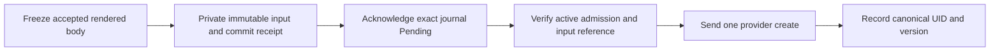

# Registry operator v2 development

This Go module is the separately developed registry operator redesign. The live
Python operator continues to own its existing workflows and resources. This
module has no installed production worker, queue, diagnostic endpoint or resource
handoff. Development and migration work is tracked in Beads epic
`tmprl-demo-cloud-registry-2f4`; use `bd show` and `bd ready` from the repository
root for current work and acceptance evidence.

## Try the rollout model

From the repository root, with the module dependencies already acquired:

```sh
go -C operator-v2 run ./cmd/registry-operator-demo --scenario success
go -C operator-v2 run ./cmd/registry-operator-demo --scenario smoke-failure --json
```

The demo uses fake providers and an in-memory journal. Its scenarios include
readiness, smoke, evidence and cleanup failure. The result keeps the candidate's
original failure separate from recovery and publication outcomes, and reports
the previously active route independently.

## Module boundaries

| Package | Responsibility |
| --- | --- |
| `internal/project` | Decode and validate raw authoring, then construct the distinct effective project type. Generated types and the canonical schema remain checked together. |
| `internal/rollout` | Compute the next rollout or drain action from typed desired and observed state, without provider I/O. |
| `internal/coordinator` | Run the small Temporal rollout workflow, signals, retries, continuation and supersession protocol. Python histories remain on their original worker. |
| `internal/diagnostics` | Bound and sanitize failures, sequenced events, operation projections, recovery results and availability. |
| `internal/ownership` | Bind exact owner, scope, incarnation, creation provenance and conditional mutation requirements. |
| `internal/journal` | Store subject-scoped attempt, write and diagnostic facts through a pinned cell and conditional versions. Ambiguous writes remain unresolved. |
| `internal/admission` | Consume clean-handoff checkpoints once through durable CAS. This requires drained callbacks and observed prior process exit. |
| `internal/runtimeconfig` | Compose finite local Namespace, ConfigMap, Deployment, Service and ServiceAccount operations with admission, retained inputs, creation receipts and durable faults. |
| `internal/deploymentjournal`, `internal/servicejournal`, `internal/serviceaccountjournal`, `internal/runtimeinputs` | Verify exact admitted child writes and retain the original rendered body privately by immutable reference. |
| `internal/candidateprep` | Freeze the complete private accepted plan before namespace creation, then select its literal Deployment/Service pair and minimal ServiceAccount prerequisite. |
| `internal/providers` | Implement reviewed Kubernetes, Temporal Cloud and candidate-secret capabilities using explicit connections and credentials. |
| `internal/render/kubernetes` | Produce typed desired objects and intents; rendering performs no writes. Traffic publication has a separate authority and phase. |
| `internal/buildplan`, `internal/buildspec`, `internal/sourceresolver` | Bind immutable build inputs, compile private execution artifacts and acquire scoped Git source into a bounded archive. |
| `internal/catalogdiagnostics` | Verify explicitly supplied sessions and live project-policy decisions, then read durable diagnostics and independent accepted intent without querying a worker. |
| `internal/simulation` | Exercise the planning/engine model with fake provider state. Its generic references are not provider-native rollout authority. |
| `testinfra` | Describe and bootstrap separately reviewed, owned test fixtures; normal tests do not discover cloud credentials or apply these plans. |

`cmd/registry-diagnostics` is a **privileged operator-local** read tool. Its only
invocation is `registry-diagnostics read-local [--json]`. Human output separates
the original cause, warnings, historical receipts, route/retry evidence and
freshness; JSON uses the same authorized view as the diagnostic page.

This tool receives an explicit Kubernetes client certificate and an HS256
session verification key. The shared HS256 key also permits issuing sessions:
this is not an ordinary team client, and production signing keys must never be
fetched, supplied or distributed for it. A future team client should call the
protected server API instead. No kubeconfig, cloud/default credential profile,
environment secret, login flow, HTTP listener or policy administration exists.

A trusted local launcher must supply independently retained namespace/cell
UIDs and creation provenance, a disposable owner/run, exact cluster identity,
one canonical target, local session configuration and credentials. Bootstrap
does not discover or adopt identities from names or current object data.
`diagnosticcli.NewSecretInputs` and `NewBootstrap` construct the opaque input;
`Bootstrap.WritePrivate` writes its canonical private wire to an anonymous pipe.
Start the executable with the read end as inherited **FD 3**, close the parent's
read handle, set a write deadline, write bootstrap, close the write end for EOF,
then wait/reap the child. **Start before writing:** bootstrap can exceed pipe
capacity. The executable accepts only a pollable pipe, with a five-second input
deadline and 128 KiB bound. Never put this input in argv, environment, logs or
workflow history. The pipe is trusted bootstrap delivery, not authentication by
itself. Session signature and current project policy are still verified.

The read path uses an explicit `kubejournal.NewReadOnly` cell: no writer is
invented, CAS always denies without RPC, and the existing canonical live read
validation remains in force. Missing/replaced sources fail closed. Explicit
trusted bootstrap production and protected server routing remain separate work.
The finite owned proof is `python3 scripts/run_operator_kube_tests.py
--diagnostic-read-local`; public prerequisite acquisition remains separate.

Provider mutation capability is narrower than rendering support. Kubernetes
execution currently supports controlled local actors; production and distributed
modes remain disabled. The diagnostic session verifier requires an explicit live
policy implementation and key provisioning before endpoint registration.

Go authoring reserves `primary` for the implicit project Temporal namespace.
Components select it by omitting `temporalNamespace`; Nexus target and caller
references may explicitly use `primary`. An additional namespace named
`primary` is rejected before planning. Historical projects using that label
remain on the legacy worker until an explicit ownership migration resolves the
label and references; the Go implementation does not rename or adopt resources.

The standalone `registry/web/static/diagnostics.mjs` panel consumes the authorized
Go read model. It requires an explicit trusted installation/project UID binding,
loads only on request, and separates original cause, cleanup, evidence,
publication, retry certainty and serving observations. It is not imported by the
live catalog. Fake DOM and Go wire contracts cover the panel independently of
the separate owned browser proof below.

The separate `diagnostic-page.html` and `diagnostic-page.mjs` compose that panel
with a bounded, authorized binding read. `catalogdiagnostics.NewLocalPage`
serves copied public assets and one configured project, disabled by default.
An owned Chromium proof exercises the real page after a failed writer exits,
including cause/warning display, historical creation receipts, manual loading,
session clearing and live policy revocation. A separate owned source-outage
proof verifies the actual diagnostic handler's 503 response and clearing of the
previous protected view while the journal remains intact. These use synthetic
sessions on isolated local HTTP networks. Production routing and login remain
separate work. Historical creation receipts do not establish current resource
existence, readiness or serving availability; missing or ambiguous associations
remain absent from the optional summary.

The ServiceAccount adapter and its admitted runtime have focused race/vet and
native API/process coverage. The preparation proof freezes the private plan
before namespace creation, waits, exits the old worker, and reaches Ready from
the same plan without reposting its ServiceAccount, Deployment or Service. A
separate case retains the canonical ServiceAccount creation receipt before an
injected read denial and blocks downstream creates. Its input family requires
explicit opt-in when bootstrapping a fresh private store; existing stores cannot
silently acquire the capability. This minimal profile disables token automount
and excludes secret/pull references and identity annotations; it does not apply
application RBAC or prove payload behavior, serving or traffic promotion.

The Go renderer intentionally omits the legacy renderer's empty `tenant-baseline`
Role and its component RoleBindings. It retains dedicated component
ServiceAccounts; the empty Role supplied no permissions. This does not establish
the ServiceAccount's effective permissions from other sources. Existing legacy
objects and bootstrap operator RBAC stay unchanged: omission does not prune,
delete, adopt or migrate them. Permission-bearing application RBAC requires a
separately reviewed contract and capability.

The retained-input Deployment runtime is a local prototype with this ordering:



On clean restart, the journal selects the original private body; the runtime
checks its complete fingerprint and current canonical resource before admission.
It never reconstructs old desired state from a live Deployment or changed project
authoring. Missing inputs and unresolved provider outcomes block normal work.
The older zero-reference resolver is an explicitly local prototype seam.
Filesystem tests establish protocol behavior with `flock` and `fsync`; they do
not simulate physical disk power loss or establish distributed fencing.

The source resolver emits a full tracked-tree tar archive. It does not provide
`.git` history, submodule/LFS fallback or complete Flux trigger-filter parity.
Private archives, authored build configuration and one-time credentials belong
inside activity execution or authorized evidence storage, never workflow history
or ordinary diagnostic responses.

## Local validation

Public acquisition and isolated execution are separate commands. The execution
tiers receive owned fixture credentials only and use a local Docker Unix socket
at the host harness. Tests never receive that socket or mount the host checkout.
The Kubernetes runner requires Docker Engine 28+ with isolated gateway support.

For the usual development loop, run these from the repository root:

```sh
make -C operator-v2 tools       # Explicit public dependency acquisition
make -C operator-v2 test-unit   # Isolated Go, UI and helper contracts
make -C operator-v2 test-local  # Unit contracts plus disposable Kubernetes
```

The targets run the same individual runners below and stop on failure. Heavy
tiers run serially, including with `make -j`. Temporal history tests remain a
separate `make -C operator-v2 test-temporal` target with the macOS prerequisites
described below. No target deploys or accesses the shared cloud accounts.

```sh
# Acquire pinned public Go dependencies, kind and node image.
python3 scripts/prepare_operator_kube_tests.py
python3 scripts/prepare_operator_go_compiler.py --acquire

# Execute compiled package tests in scratch containers with no network.
python3 scripts/run_operator_go_unit_tests.py

# Prove actual two-process metadata CAS in its own no-network scratch tier.
python3 scripts/run_operator_go_unit_tests.py --metadata-process

# Prove synthetic candidate headers and connection closure over owned local TLS.
python3 scripts/run_operator_go_unit_tests.py --credential-observation-wire

# Compose a staged actor's private read guard with actual owned local TLS.
python3 scripts/run_operator_go_unit_tests.py --credential-staging-observation-wire

# Exercise the real helper CLIs through synthetic anonymous credential pipes.
# The scratch container has no AWS credentials or external network access.
python3 scripts/run_operator_go_unit_tests.py --aws-permission-invocation-process

# Exercise a disposable owned Kubernetes API, controllers and process handoffs.
python3 scripts/run_operator_kube_tests.py

# Separate finite preparation proof, including the original private plan,
# ServiceAccount prerequisite and clean Waiting-to-Ready process handoff.
python3 scripts/run_operator_kube_tests.py --candidate-preparation

# Acquire the pinned public Python image, then exercise stdlib build helpers.
python3 scripts/prepare_operator_python_tests.py
python3 scripts/run_operator_python_tests.py --self-check

# Acquire the pinned official Node image, then check the Go/UI wire contract
# and the standalone panel in isolated execution containers.
python3 scripts/prepare_operator_node_tests.py --acquire
python3 scripts/verify_diagnostic_ui_contract.py
python3 scripts/tests/test_node_runner_contract.py
python3 scripts/run_operator_node_tests.py

# Optional real browser tier: acquire public inputs explicitly, then prove
# the browser sandbox and the real diagnostic page on owned isolated networks.
python3 scripts/prepare_operator_browser_tests.py --acquire
python3 scripts/run_operator_browser_boundary.py
python3 scripts/run_operator_kube_tests.py --diagnostic-browser
python3 scripts/run_operator_kube_tests.py --diagnostic-browser-source-unavailable
```

For Go-only dependency acquisition, use
`python3 scripts/prepare_operator_kube_tests.py --go-only`.
The credential wire mode selects one finite opt-in test inside the no-network
scratch tier. Default tests omit its socket code; never run its build tag on the
host. It proves local synthetic authentication/routing and closure, without
claiming cloud permissions, promotion or workflow/worker readiness.
The macOS legacy and local Temporal tiers use an additional OS execution profile:

```sh
python3 scripts/run_operator_baseline.py
python3 scripts/run_operator_temporal_tests.py --go --timeout 150
```

The local Temporal tier verifies real history replay and worker replacement
against its owned local server. The Kubernetes tier covers actual API UID/version
conditions, lifecycle protection, lost acknowledgements, durable journal reads
and controlled child-process handoff. These proofs have different boundaries;
none substitutes for shared-cloud effective-permission tests or a production
single-writer migration.

For a focused Kubernetes reproof, pass `--tests` with comma-separated exact
top-level Go test names. The runner always includes its owned API/network proof
and rejects missing, skipped or duplicate case results. The default runs the
full suite. Node tests verify the exact public asset snapshot, bounded manual
client and native network/credential boundary; they use a fake DOM rather than a
browser. The separate `--diagnostic-browser` mode runs Chromium against the real
Go page after the writer process exits, including live policy revocation. Its
browser receives no Kubernetes connection; the Go fixture alone receives one
read-only synthetic connection file. No host ports are published. Public Node
image staging may resolve pinned registry metadata through
BuildKit; the test container itself runs with networking disabled.

The pull-request workflow `.github/workflows/operator-v2-local-contracts.yaml`
runs local contracts with read-only repository permission and no cloud identity
or deployment step. Fixture JSON files are included in isolated images through
an explicit public-file allowlist; private plans, state and credentials are
excluded.

The literal-workload observer compares the complete retained ReplicaSet template
and Pod specification against a closed Kubernetes v1.37 comparison contract. It
supports literal environment values, the minimal canonical ServiceAccount and
an explicitly pinned current local Node; dependency references and injected
containers, volumes or scheduling settings are refused. Its private Pod UID set
must match the endpoint-publication sample. This is current API declaration
equality under the trusted owned bootstrap, not installed-admission attestation,
creator provenance, actual process values, placement attestation or promotion
authority. The previous ancestry-only endpoint API retains its narrower claim.

The focused test
`TestLiteralWorkloadCurrentDeclarationAndAPIMediatedServing` composes real runtime
NS/SA/Deployment/Service creates, private inputs and acknowledged receipts. Its
fixed bounded `/ready` request uses the Kubernetes API Service proxy and checks
the accepted literal response between matching private Pod-identity samples.
That observation is API-mediated backend serving; it does not exercise the
ClusterIP/kube-proxy path, DNS or ingress. An owned same-UID toleration addition
must invalidate declaration equality. The owned native proof passed in 60.83s
with its mandatory API/network boundary and verified owned-resource cleanup.
It establishes the bounded declaration and API-mediated serving observations
above; no production capability is enabled by its DTO.

## Shared-account fixtures

Reviewed fixture definitions and safe design envelopes live under
`testinfra/fixtures`. Actual plan approval, canonical provider IDs, state lineage,
attestations and cleanup gates are recorded in Beads and ignored private fixture
directories. State is local to each fixture module and separate from production
infrastructure state.

Only an exact reviewed plan or request is authorized for execution. Fixture
expiry tags do not delete resources; retained resources, unknown outcomes and
KMS pending-deletion windows require explicit owned cleanup. Namespace/API-key
creation, synthetic seeding, role assumptions and permission probes each have
their own concrete review and evidence. Production cutover and rollback require
the separately tracked migration acceptance, including a single active writer.
